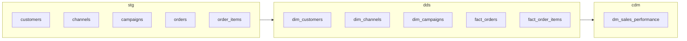

# Продажи и маркетинговые кампании

Учебное хранилище в Greenplum. Сырые данные генерируются в базе, складываются в звезду и собираются в одну витрину для отчётов по ROI, новым клиентам, бюджету и каналам.

`stg` хранит сгенерированные строки как есть. `dds` раскладывает их на справочники и факты. `cdm` считает показатели по дню и кампании, только по завершённым заказам.

Скрипты лежат в `sql/` и запускаются по номерам, с `01_schemas.sql` по `08_optimize.sql`. Как устроены слои и метрики, написано в [report/architecture.md](report/architecture.md).
