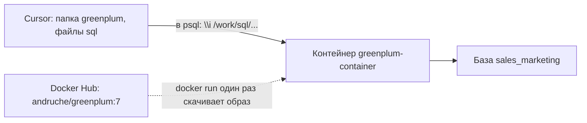

# Самостоятельная сборка DWH в Greenplum

Источник требований — [Итоговый проект модуля.pdf](Итоговый%20проект%20модуля.pdf) в папке проекта. Автопроверка смотрит обязательные объекты, объёмы и согласованность агрегатов, а не совпадение SQL с эталоном.

Делаем только обязательный контур. Эти пункты из PDF не реализуем: витрину по товарам, предагрегат через `CREATE TABLE AS SELECT`, отдельные `VIEW`, политику удаления старых заказов.

Как работаем: вы пишете SQL в Cursor и выполняете его в контейнере. После каждого шага присылаете скрипт и результат контрольного запроса. Я разбираю ошибки, готовый проект за вас не собираю.

## Где что лежит

Два разных места. Путать их не нужно.

Тексты запросов — на Маке, в этом проекте Cursor:

- папка `/Users/roman/Desktop/Cursor/greenplum`
- сюда кладёте `sql/*.sql` и `report/architecture.md`
- PDF задания уже лежит здесь
- терминал открываете в Cursor: меню Terminal → New Terminal. Текущая папка должна быть этот проект (`pwd` печатает путь выше)

База — не файл и не сайт. Её нет в PDF, на курсе её не выдают, с VPS из других проектов её не берут. Вы ставите программу Greenplum себе на Мак одной командой Docker. Внутри неё уже есть пустой кластер и служебная база `postgres`. Учебную базу `sales_marketing` создаёте сами командой `CREATE DATABASE`. Таблицы и строки появляются только после ваших `CREATE TABLE` и `INSERT`.

Откуда берётся программа:

- страница образа: [hub.docker.com/r/andruche/greenplum](https://hub.docker.com/r/andruche/greenplum)
- имя образа: `andruche/greenplum:7`
- первая команда `docker run` сама скачивает образ с Docker Hub. Отдельно базу или дамп качать не нужно
- Docker на этом Маке уже установлен (клиент 29.8.0). Ставить Docker заново не надо. Перед работой откройте приложение Docker Desktop и дождитесь, пока оно запущено (иконка кита в строке меню)

Куда подключаться. У Greenplum в этом образе нет веб-страницы. Адрес `http://localhost:5433` в браузере ничего не откроет: это порт протокола базы, не сайт.

На этом Маке порт 5432 уже занят локальным PostgreSQL 17 (`/Library/PostgreSQL/17`). Его не останавливаем. Greenplum снаружи публикуется на порту 5433, внутри контейнера база по-прежнему слушает 5432.

Карточка подключения, если позже откроете DBeaver или DataGrip. Для задания достаточно `psql` внутри контейнера, отдельную программу ставить не нужно.

- хост с Мака: `127.0.0.1`
- порт с Мака: `5433`
- пользователь: `gpadmin`
- пароль: пустой. Так написано на странице образа, «access without password by default»
- база, в которой делаете проект: `sales_marketing`
- база, куда заходите один раз, только чтобы создать `sales_marketing`: `postgres`

Внутри контейнера хост и порт 5433 не нужны: `psql` там уже стоит и смотрит на локальный кластер. Порт 5433 на Маке — это «дырка» наружу из контейнерного порта 5432.

Автопроверка. В PDF нет ссылки и нет отдельного сервера, куда логиниться. Кнопка или скрипт проверки живут в том же уроке курса, откуда скачан PDF. Готовую базу проверка не приносит: она смотрит объекты, которые вы создали. Когда дойдёте до сдачи и на экране будет конкретная кнопка, поле загрузки или команда — пришлите, что именно там написано.



Файлы, которые создаёте сами, и порядок запуска:

- `sql/00_database.sql` — только комментарий, что базу создают отдельно из `postgres`. `CREATE DATABASE` неудобно мешать с остальным
- `sql/01_schemas.sql`
- `sql/02_stg_ddl.sql`
- `sql/03_stg_load.sql`
- `sql/04_dds_ddl.sql`
- `sql/05_dds_load.sql`
- `sql/06_cdm.sql`
- `sql/07_reports.sql`
- `sql/08_optimize.sql`
- `report/architecture.md` — отчёт на 1–2 страницы

Повторный прогон этих файлов с чистой базы должен давать то же состояние. Строки руками в `psql` «чтобы прошло» не правят.

## Зафиксируйте логику метрик до DDL

Иначе витрина не сойдётся с контрольной агрегацией, и автопроверка базовых сумм упадёт.

Зерно витрины: одна строка на пару `(report_dt, campaign_id)`. Канал — атрибут кампании, дробить зерно он не должен. `report_dt` — это `order_dt::date`.

В расчёт входят только строки с `order_status = 'completed'`.

- `orders_count` — `COUNT(*)` завершённых заказов
- `customers_count` — `COUNT(DISTINCT customer_id)`
- `order_amount` — `SUM(order_amount)` заголовка заказа
- `avg_order_amount` — `order_amount / NULLIF(orders_count, 0)`
- `revenue` — то же, что `order_amount`
- `campaign_budget` — полный бюджет кампании на каждой дневной строке
- `spend` — дневная доля: `budget / (end_dt - start_dt + 1)`. Тогда сумма `spend` по дням кампании равна бюджету
- `roi` — `(revenue - spend) / NULLIF(spend, 0)`
- `new_customers` — клиенты, для которых этот день является датой первого завершённого заказа, а кампания строки — кампания этого первого заказа

В отчёте «топ кампаний» ROI считайте заново из сумм: `(SUM(revenue) - SUM(spend)) / NULLIF(SUM(spend), 0)`. Среднее дневных ROI — другая величина.

Цены `order_items` с суммой заголовка заказа не склеиваем. Витрина считается от `orders.order_amount`. В отчёте одна фраза: позиции сгенерированы отдельно и в KPI не входят.

## Шаг 1. Контейнер и пустая база

Где: терминал Cursor, папка проекта. Не браузер и не VPS.

Сначала убедитесь, что Docker Desktop запущен. Затем одна команда. Флаг `-v` показывает контейнеру вашу папку проекта как каталог `/work`, чтобы `psql` читал файлы, которые вы правите в Cursor.

Порт 5432 на Маке занят локальным PostgreSQL 17, поэтому наружу пробрасываем 5433. Первая попытка с `-p 5432:5432` уже падала с `bind: address already in use` и оставляла контейнер в статусе `Created`. Перед новым запуском это имя нужно снять:

```bash
docker rm greenplum-container
```

Если такой контейнер уже успешно работает на 5433, `docker rm` не нужен: смотрите `docker ps` и переходите ко входу в `psql`.

```bash
docker run --name greenplum-container \
  -p 5433:5432 \
  -v /Users/roman/Desktop/Cursor/greenplum:/work \
  -d andruche/greenplum:7
```

Что произойдёт: Docker скачает образ (только первый раз, сотни мегабайт), создаст контейнер с именем `greenplum-container` и запустит его в фоне. Базы `sales_marketing` на этом шаге ещё нет.

Проверка, что контейнер жив:

```bash
docker ps --filter name=greenplum-container
```

В колонке STATUS должно быть `Up`, в PORTS — `0.0.0.0:5433->5432/tcp`.

Команда `docker exec` заходит внутрь контейнера, поэтому в ней порт 5433 не указывается. В DBeaver с Мака порт именно `5433`.

Вход в базу. Это снова терминал на Маке. Команда открывает `psql` уже внутри контейнера, под пользователем `gpadmin`, в служебной базе `postgres`:

```bash
docker exec -it greenplum-container su - gpadmin -c "psql -d postgres"
```

Приглашение станет похоже на `postgres=#`. Пароль не спрашивается. Команда `\conninfo` показывает, куда вы попали: пользователь `gpadmin`, база `postgres`.

С этого момента вы больше не в терминале Мака. Два приглашения выглядят по-разному:

- терминал Мака: `(base) roman@MacBook-Air-Roman greenplum %` — здесь вводят `docker`
- база: `postgres=#` или `sales_marketing=#` — здесь вводят SQL и команды `psql` на `\`. Слово `docker` в этом приглашении вводить нельзя

Если после ошибочной команды приглашение стало `sales_marketing-#`, нажмите `Ctrl+C`, пока оно снова не станет `sales_marketing=#`.

Дальше в приглашении `postgres=#` создаёте учебную базу и переходите в неё:

```sql
CREATE DATABASE sales_marketing;
```

```text
\c sales_marketing
```

`\c` — команда клиента `psql`, не SQL. В файл её не кладут. После неё приглашение меняется на `sales_marketing=#`, `\conninfo` показывает уже `sales_marketing`. Все следующие шаги выполняются только в ней. В `postgres` таблицы проекта не создают.

Выход из `psql` обратно в терминал Мака: `\q`. Контейнер при этом продолжает работать. Пока вы на шагах 2–9, выходить не нужно.

Как выполнять файл, который вы написали в Cursor. Приглашение должно быть `sales_marketing=#`. Вводите команду `psql`, не `docker`:

```text
\i /work/sql/01_schemas.sql
```

`/work` — папка проекта, как её видит контейнер. Для следующего файла меняется только имя: `\i /work/sql/02_stg_ddl.sql` и так далее. Если `psql` пишет, что файла нет, контейнер запущен без флага `-v`.

Подсказка запроса мне: «Контейнер не стартует или psql не пускает. Вот команда и текст ошибки целиком».

## Шаг 2. Схемы

Где писать: файл `sql/01_schemas.sql` в Cursor. Где выполнять: приглашение `sales_marketing=#`, команда `\i /work/sql/01_schemas.sql`. Команду `docker` здесь не вводят.

Три схемы: `stg` (как сгенерировали), `dds` (измерения и факты), `cdm` (витрина).

```sql
CREATE SCHEMA IF NOT EXISTS stg;
CREATE SCHEMA IF NOT EXISTS dds;
CREATE SCHEMA IF NOT EXISTS cdm;
```

Проверка в том же `psql`:

```sql
SELECT nspname FROM pg_namespace WHERE nspname IN ('stg','dds','cdm');
```

Ожидаются три строки. Список баз `\l` здесь ни при чём: схемы живут внутри `sales_marketing`, а не рядом с ней.

## Шаг 3. Таблицы STG

Где писать: `sql/02_stg_ddl.sql`. Где выполнять: в приглашении `sales_marketing=#` команда `\i /work/sql/02_stg_ddl.sql`.

DDL пишете сами. Ориентир по типам: идентификаторы `integer`, имена `text`, даты `date`, деньги `numeric(14,2)`, количество `integer`, статус `text`.

Обязательные колонки:

- `stg.customers`: `customer_id`, `customer_name`, `signup_dt`, `region`, `customer_segment`
- `stg.channels`: `channel_id`, `channel_name`, `channel_type`
- `stg.campaigns`: `campaign_id`, `campaign_name`, `channel_id`, `start_dt`, `end_dt`, `budget`
- `stg.orders`: `order_id`, `order_dt`, `customer_id`, `campaign_id`, `order_amount`, `order_status`
- `stg.order_items`: `order_item_id`, `order_id`, `product_id`, `product_name`, `quantity`, `price`

Как выбирать распределение. Greenplum режет таблицу на сегменты по хешу ключа. Одинаковый ключ у двух больших таблиц даёт локальный join без пересылки. Маленькую таблицу кладут целиком на каждый сегмент (`DISTRIBUTED REPLICATED`).

- `channels`, `campaigns`, `customers` — `DISTRIBUTED REPLICATED`. В задании это 4, 10 и 100 строк, их присоединяют к фактам
- `orders` и `order_items` — `DISTRIBUTED BY (order_id)`, чтобы позиции лежали на том же сегменте, что и заголовок

Партиция обязательна по смыслу задания, но не на каждой таблице. Партиционируете `stg.orders` по `order_dt`, помесячно, плюс default-партиция. `order_items` без своей даты не партиционируете. Окно дат одно на весь проект: `2024-01-01` … `2024-06-30`, граница партиций `2024-07-01` не включая.

```sql
CREATE TABLE stg.orders (
    order_id integer,
    order_dt date,
    customer_id integer,
    campaign_id integer,
    order_amount numeric(14,2),
    order_status text
)
DISTRIBUTED BY (order_id)
PARTITION BY RANGE (order_dt)
(
    START (DATE '2024-01-01') INCLUSIVE
    END (DATE '2024-07-01') EXCLUSIVE
    EVERY (INTERVAL '1 month'),
    DEFAULT PARTITION other
);
```

Если этот синтаксис образ не примет, пришлите текст ошибки. Запасной вариант — декларативные партиции `PARTITION BY RANGE` и отдельные `CREATE TABLE ... PARTITION OF`.

Уникальные ограничения в этом проекте не используем как защиту качества. Уникальность даёт генератор: один `generate_series` — один идентификатор.

Проверка: в `psql` команда `\d+ stg.orders` показывает Distributed by и список дочерних партиций. `\dt stg.*` показывает пять таблиц.

Подсказка запроса мне: «Проверь распределение и партиции. Вот `02_stg_ddl.sql` и вывод `\d+ stg.orders`».

## Шаг 4. Генерация STG

Где писать: `sql/03_stg_load.sql`. Где выполнять: в приглашении `sales_marketing=#` команда `\i /work/sql/03_stg_load.sql`.

Минимум: 100 клиентов, 4 канала, 10 кампаний, 600 заказов, 2000 позиций. Способ: `INSERT ... SELECT` от `generate_series`, ветки `CASE`, `random()`.

Скопируйте запросы ниже в `sql/03_stg_load.sql` целиком. `TRUNCATE` стоит первым: повторный запуск не удваивает строки. Порядок вставки: каналы, клиенты, кампании, заказы, позиции. Дата заказа считается от уже вставленной кампании и попадает в `[start_dt, end_dt]`. Около трёх четвертей заказов получают статус `completed`.

```sql
TRUNCATE stg.order_items, stg.orders, stg.campaigns, stg.customers, stg.channels;

INSERT INTO stg.channels (channel_id, channel_name, channel_type)
SELECT
    g,
    CASE g
        WHEN 1 THEN 'email'
        WHEN 2 THEN 'social'
        WHEN 3 THEN 'search'
        ELSE 'display'
    END,
    CASE WHEN g = 4 THEN 'offline' ELSE 'online' END
FROM generate_series(1, 4) AS g;

INSERT INTO stg.customers (customer_id, customer_name, signup_dt, region, customer_segment)
SELECT
    g,
    'customer_' || g,
    DATE '2023-06-01' + (random() * 400)::int,
    CASE g % 4
        WHEN 0 THEN 'Москва'
        WHEN 1 THEN 'Санкт-Петербург'
        WHEN 2 THEN 'Казань'
        ELSE 'Новосибирск'
    END,
    CASE g % 3
        WHEN 0 THEN 'new'
        WHEN 1 THEN 'regular'
        ELSE 'vip'
    END
FROM generate_series(1, 100) AS g;

INSERT INTO stg.campaigns (campaign_id, campaign_name, channel_id, start_dt, end_dt, budget)
SELECT
    g,
    'campaign_' || g,
    1 + (g % 4),
    DATE '2024-01-01' + ((g - 1) * 15),
    DATE '2024-01-01' + ((g - 1) * 15) + 40,
    round((10000 + random() * 90000)::numeric, 2)
FROM generate_series(1, 10) AS g;

INSERT INTO stg.orders (order_id, order_dt, customer_id, campaign_id, order_amount, order_status)
SELECT
    g,
    c.start_dt + (random() * (c.end_dt - c.start_dt + 1))::int,
    1 + (random() * 99)::int,
    c.campaign_id,
    round((100 + random() * 9900)::numeric, 2),
    CASE
        WHEN random() < 0.75 THEN 'completed'
        WHEN random() < 0.90 THEN 'cancelled'
        ELSE 'returned'
    END
FROM generate_series(1, 600) AS g
JOIN stg.campaigns AS c ON c.campaign_id = 1 + (g % 10);

INSERT INTO stg.order_items (order_item_id, order_id, product_id, product_name, quantity, price)
SELECT
    g,
    1 + (random() * 599)::int,
    1 + (g % 20),
    CASE g % 5
        WHEN 0 THEN 'Чай'
        WHEN 1 THEN 'Кофе'
        WHEN 2 THEN 'Сахар'
        WHEN 3 THEN 'Молоко'
        ELSE 'Печенье'
    END,
    1 + (random() * 4)::int,
    round((50 + random() * 950)::numeric, 2)
FROM generate_series(1, 2000) AS g;
```

Проверка в `psql` базы `sales_marketing`:

```sql
SELECT COUNT(*) FROM stg.customers;      -- >= 100
SELECT COUNT(*) FROM stg.channels;       -- >= 4
SELECT COUNT(*) FROM stg.campaigns;      -- >= 10
SELECT COUNT(*) FROM stg.orders;         -- >= 600
SELECT COUNT(*) FROM stg.order_items;    -- >= 2000
```

```sql
SELECT order_status, COUNT(*) FROM stg.orders GROUP BY 1;

SELECT COUNT(*) FROM stg.orders o
JOIN stg.campaigns c ON c.campaign_id = o.campaign_id
WHERE o.order_dt < c.start_dt OR o.order_dt > c.end_dt;  -- 0
```

Подсказка запроса мне: «Генерация заказов даёт даты вне кампании или мало completed. Вот `03_stg_load.sql` и оба контрольных SELECT».

## Шаг 5. DDS

Где писать: `sql/04_dds_ddl.sql`, затем `sql/05_dds_load.sql`. Где выполнять: в приглашении `sales_marketing=#` сначала `\i /work/sql/04_dds_ddl.sql`, потом `\i /work/sql/05_dds_load.sql`.

Измерения: `dds.dim_customers`, `dds.dim_channels`, `dds.dim_campaigns`. Факты: `dds.fact_orders`, `dds.fact_order_items`.

В каждой таблице натуральный ключ (`customer_id`, `channel_id`, `campaign_id`, `order_id`, `order_item_id`), те же бизнес-атрибуты, что в STG, и служебные колонки `load_dt timestamp`, `load_src text`. Отдельные суррогатные ключи не вводим.

Распределение как в STG: справочники `REPLICATED`, оба факта `DISTRIBUTED BY (order_id)`. Партиция по `order_dt` тем же окном — у `dds.fact_orders`. На факте заказов обязательно оставьте `order_dt`, `customer_id`, `campaign_id`, `order_status`, `order_amount`.

Загрузка — `INSERT ... SELECT`. Для измерений можно `SELECT DISTINCT`. В `load_src` пишите имя источника: `'stg.customers'`, `'stg.orders'` и так далее. `load_dt` — `CURRENT_TIMESTAMP`.

```sql
INSERT INTO dds.dim_customers (
    customer_id, customer_name, signup_dt, region, customer_segment, load_dt, load_src
)
SELECT customer_id, customer_name, signup_dt, region, customer_segment,
       CURRENT_TIMESTAMP, 'stg.customers'
FROM stg.customers;
```

В начале `05_dds_load.sql` очищайте приёмник: сначала факты, потом измерения (`TRUNCATE`). Иначе второй прогон удвоит строки.

Проверка — пять `COUNT(*)` по таблицам DDS не меньше соответствующих STG, затем:

```sql
SELECT COUNT(*) FROM dds.fact_orders f
LEFT JOIN dds.dim_customers c ON c.customer_id = f.customer_id
WHERE c.customer_id IS NULL;  -- 0

SELECT COUNT(*) FROM dds.fact_orders f
LEFT JOIN dds.dim_campaigns c ON c.campaign_id = f.campaign_id
WHERE c.campaign_id IS NULL;  -- 0
```

Подсказка запроса мне: «После загрузки DDS counts не сходятся со STG. Вот `05_dds_load.sql` и COUNT по пяти таблицам».

## Шаг 6. Витрина

Где писать: `sql/06_cdm.sql`. Где выполнять: в приглашении `sales_marketing=#` команда `\i /work/sql/06_cdm.sql`. Объект один: `cdm.dm_sales_performance`.

Колонки: `report_dt`, `campaign_id`, `campaign_name`, `channel_id`, `channel_name`, `orders_count`, `customers_count`, `order_amount`, `avg_order_amount`, `new_customers`, `campaign_budget`, `spend`, `revenue`, `roi`.

Распределение: `DISTRIBUTED BY (campaign_id)`. Партицию на витрине не делаем: обязательное партиционирование уже на `stg.orders` и `dds.fact_orders`.

Каркас, который нужно дописать до рабочего `INSERT ... SELECT`:

```sql
-- completed: fact_orders WHERE order_status = 'completed'
-- first_orders: customer_id, MIN(order_dt) AS first_dt  -- только completed
-- daily: GROUP BY order_dt, campaign_id
--   COUNT(*)                      AS orders_count
--   COUNT(DISTINCT customer_id)   AS customers_count
--   SUM(order_amount)             AS order_amount
-- join dim_campaigns → имя, channel_id, budget, start_dt, end_dt
-- join dim_channels  → channel_name
-- spend   = budget / (end_dt - start_dt + 1)
-- revenue = order_amount
-- roi     = (revenue - spend) / NULLIF(spend, 0)
-- new_customers = COUNT(DISTINCT customer_id) FILTER (WHERE order_dt = first_dt)
```

Перед повторной загрузкой — `TRUNCATE cdm.dm_sales_performance`.

Проверка в той же базе:

```sql
SELECT * FROM cdm.dm_sales_performance LIMIT 10;

SELECT SUM(orders_count), SUM(order_amount) FROM cdm.dm_sales_performance;

SELECT COUNT(*), SUM(order_amount)
FROM dds.fact_orders
WHERE order_status = 'completed';
```

Две пары чисел должны совпасть. Затем:

```sql
SELECT COUNT(*) FROM cdm.dm_sales_performance
WHERE orders_count < 0
   OR customers_count > orders_count
   OR spend <= 0
   OR roi IS NULL;
```

Этот запрос должен вернуть 0.

Подсказка запроса мне: «Витрина не сходится с фактом. Вот SELECT витрины и оба проверочных агрегата с числами».

## Шаг 7. Четыре отчёта

Где писать: `sql/07_reports.sql`. Где выполнять: в приглашении `sales_marketing=#` команда `\i /work/sql/07_reports.sql`. Каждый запрос читает только `cdm.dm_sales_performance`. После запуска смотрите, что строки непустые.

1. Топ кампаний по ROI. Группировка `campaign_id, campaign_name`. ROI из сумм, не среднее дневных ROI. `ORDER BY roi DESC`.
2. Затраты против бюджета. На кампанию `SUM(spend)` и бюджет один раз через `MAX(campaign_budget)`. Разница этих двух величин около нуля — это ожидаемый результат дневной доли.
3. Новые клиенты. `SUM(new_customers)` по кампании. `customers_count` по дням не суммируйте: один клиент попадёт в несколько дней.
4. Каналы. Группировка `channel_id, channel_name`: заказы, выручка, расход, ROI из сумм.

Подсказка запроса мне: «Отчёт по бюджету задваивает spend или budget. Вот запрос и первые строки».

## Шаг 8. Оптимизация

Где писать: `sql/08_optimize.sql`. Где выполнять: в приглашении `sales_marketing=#` команда `\i /work/sql/08_optimize.sql`, после того как данные уже лежат в базе. Запросы `EXPLAIN ANALYZE` из этого шага можно вставить в то же приглашение вручную и скопировать текст плана.

```sql
ANALYZE stg.orders;
ANALYZE stg.order_items;
ANALYZE dds.fact_orders;
ANALYZE dds.fact_order_items;
ANALYZE dds.dim_customers;
ANALYZE dds.dim_campaigns;
ANALYZE dds.dim_channels;
ANALYZE cdm.dm_sales_performance;
```

Два плана, вывод сохраняете в черновик отчёта:

```sql
EXPLAIN ANALYZE
SELECT *
FROM cdm.dm_sales_performance
WHERE report_dt >= DATE '2024-03-01'
  AND report_dt < DATE '2024-04-01';

EXPLAIN ANALYZE
SELECT o.order_id, c.customer_segment
FROM dds.fact_orders o
JOIN dds.dim_customers c ON c.customer_id = o.customer_id
WHERE o.order_status = 'completed';
```

В тексте плана ищите:

- отсечение партиций по дате (`Partitions selected` или скан только одной месячной дочерней таблицы)
- `Redistribute Motion` — строки пересылаются между сегментами, ключ join не совпал с распределением
- на replicated-измерении отдельной пересылки справочника быть не должно

Индексы не создаём. На сотнях строк они ничего не меняют. В отчёте так и пишете: индекс не использовался, рычаг на этом объёме — `DISTRIBUTED BY (order_id)` у факта и позиций плюс помесячная партиция заказов. Для большого объёма в том же абзаце достаточно одной фразы: фильтр по месяцу отрезал бы лишние партиции, а справочники остались бы replicated, пока помещаются на сегмент.

Подсказка запроса мне: «Вот EXPLAIN ANALYZE. Где лишний Motion и что поменять в DISTRIBUTED BY».

## Шаг 9. Сверка и чистый прогон

Всё ещё база `sales_marketing` внутри контейнера. Сверьтесь со списком из PDF до автопроверки на курсе:

- схемы `stg`, `dds`, `cdm`
- обязательные таблицы и колонки, включая `load_dt` и `load_src` на измерениях и фактах
- минимумы строк в STG и ненулевые DDS
- витрина заполнена, в ней есть `new_customers`, `revenue`, `spend`, `roi`
- в расчёт не попали `cancelled` и `returned`
- `SUM(orders_count)` и `SUM(order_amount)` витрины равны `COUNT(*)` и `SUM(order_amount)` завершённых фактов

Потом воспроизводимость. В `psql`:

```sql
DROP SCHEMA stg, dds, cdm CASCADE;
```

Базу `sales_marketing` при этом не удаляете. Не выходя из `psql`, по очереди выполните `\i /work/sql/01_schemas.sql` … `\i /work/sql/08_optimize.sql`. Ручных `INSERT` между ними нет. Counts после второго прогона те же по минимумам задания.

Автопроверка запускается там, где курс её показывает, не по адресу Docker. Если она ругается, правьте скрипт и пересоздавайте объект, не отдельные строки. Текст проверки можно прислать целиком.

## Шаг 10. Короткий отчёт

Где: `report/architecture.md` в папке проекта, 1–2 страницы. Это текст для сдачи, его в базу не загружают.

- путь STG → DDS → CDM и зерно витрины `(report_dt, campaign_id)`
- почему справочники replicated, факты и позиции по `order_id`, партиция по месяцу только у заказов
- формулы `spend`, `revenue`, `roi`, `new_customers` и почему бюджет на дневных строках не суммируют
- что показал `EXPLAIN ANALYZE` и почему индекс не создавался

## Что присылать после шагов

Один шаг за сообщение:

- после 1: вывод `\conninfo` уже в `sales_marketing`
- после 3: `02_stg_ddl.sql` и `\d+ stg.orders`
- после 4: пять `COUNT` и доли статусов
- после 5: counts DDS и два запроса на потерянные ключи
- после 6: сравнение сумм витрины и завершённых фактов
- после 8: два плана `EXPLAIN ANALYZE`

Формулировка: «Шаг N. Ожидал X, получил Y. Скрипт ниже, вывод ниже».
